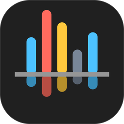
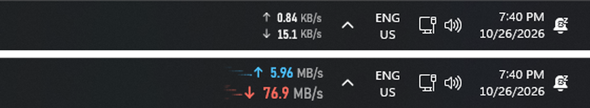
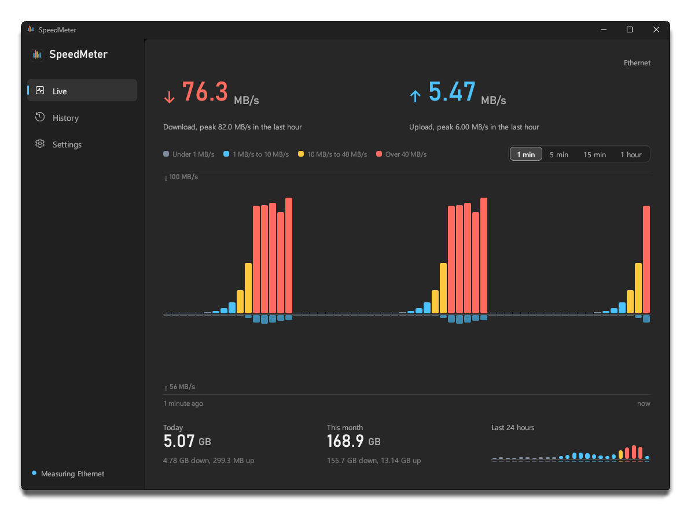
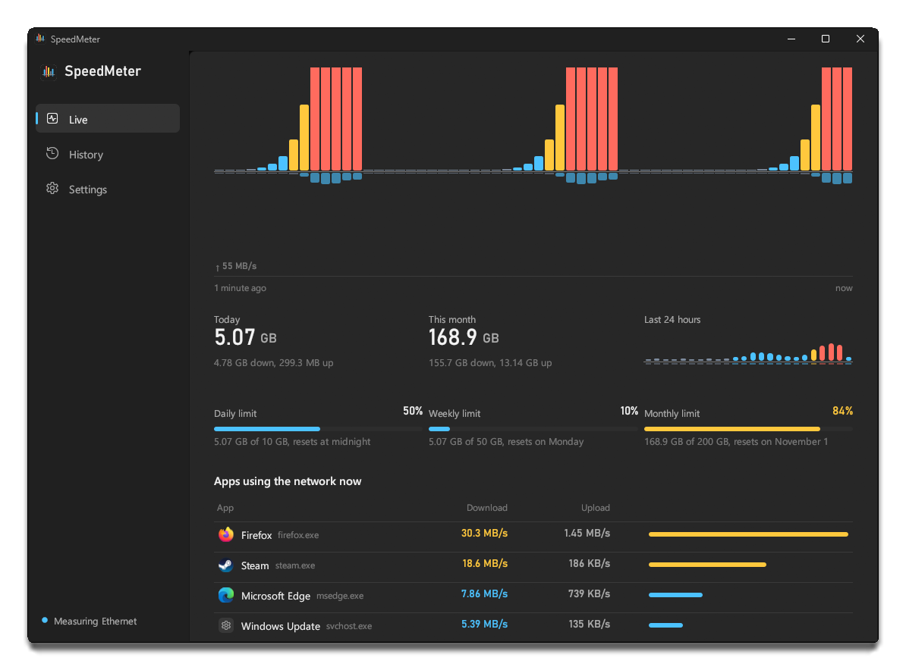
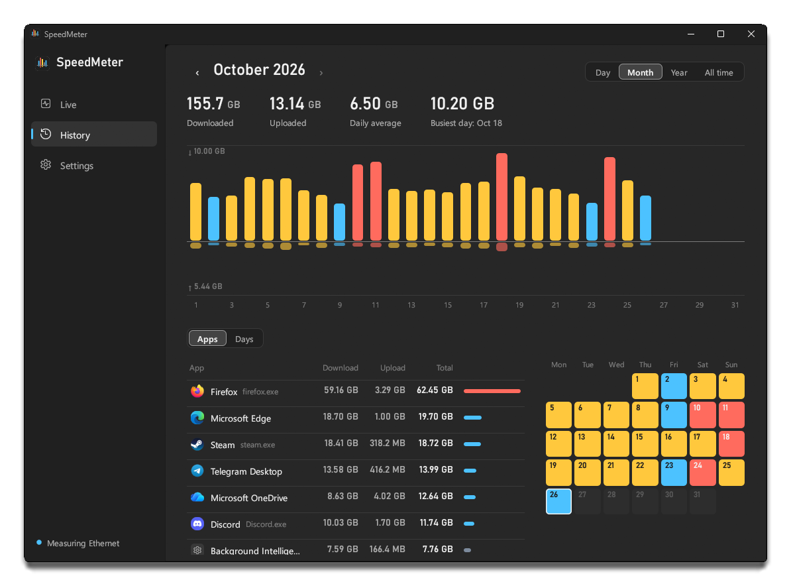
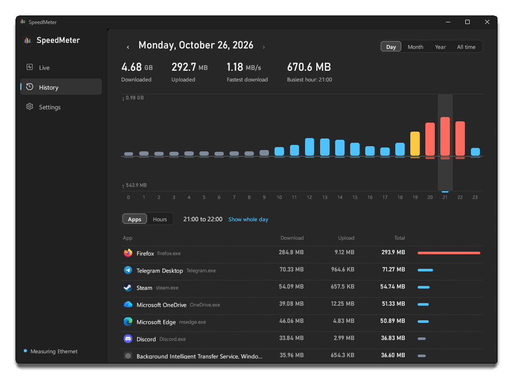
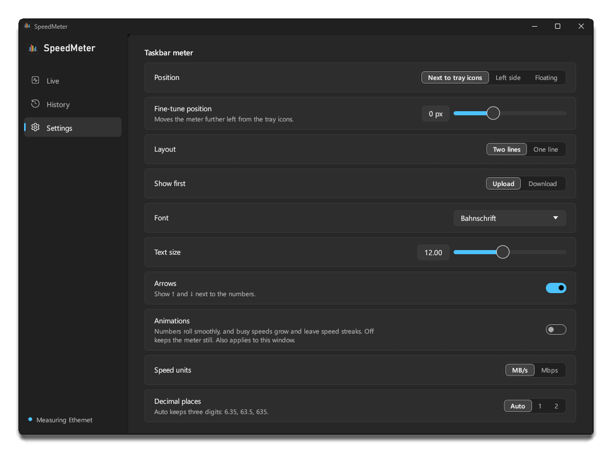
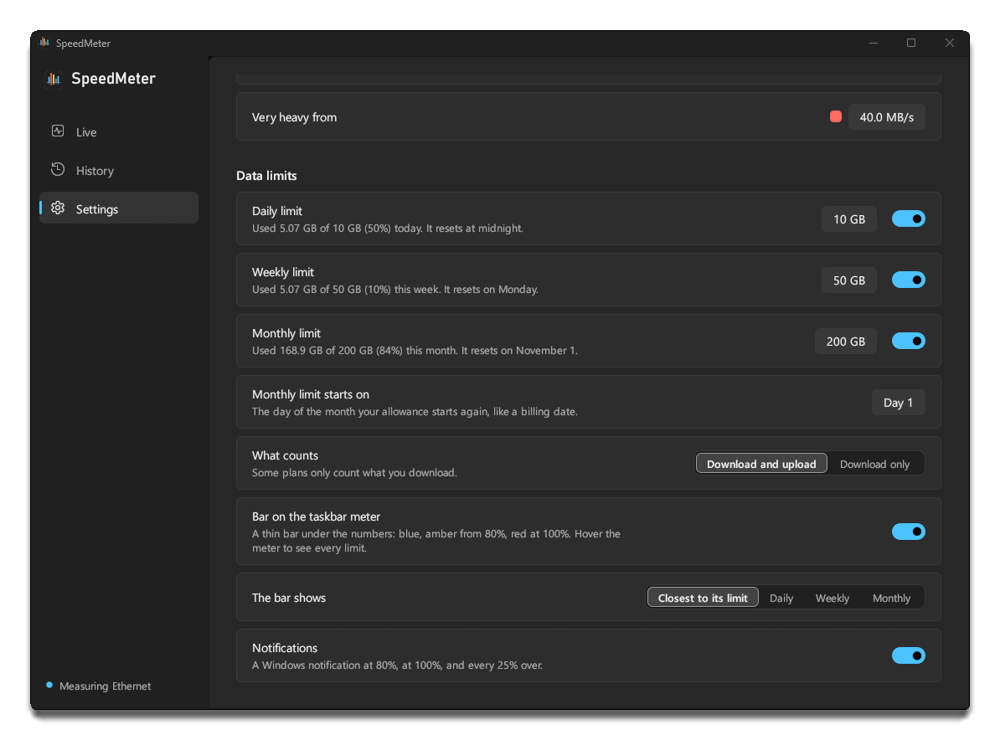
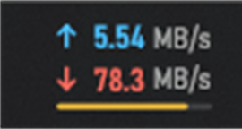

  

<h1 align="center">SpeedMeter</h1>

  A network speed meter that lives in the Windows 11 taskbar, with live charts, a full traffic history, the apps that used your data, and data limits. 
  Written in Rust. Native, small, and quiet on resources.

  <a href="https://github.com/PercyGFX/speedmeter/releases/latest"><b>Download the latest release</b></a>
  &nbsp;&nbsp;|&nbsp;&nbsp; <a href="CHANGELOG.md">What's new</a>
  &nbsp;&nbsp;|&nbsp;&nbsp; Windows 11, 64-bit (Windows 10 1809+ should also work)

  

---

## Contents

- [Features](#features)
- [Screenshots](#screenshots)
- [Install](#install)
- [Using SpeedMeter](#using-speedmeter)
- [Per-app usage](#per-app-usage)
- [Data limits](#data-limits)
- [Your data](#your-data)
- [Updates](#updates)
- [Uninstall](#uninstall)
- [Troubleshooting](#troubleshooting)
- [For developers](#for-developers)
- [License](#license)

## Features

**In the taskbar**

- Upload and download speed, right next to the tray icons. Or after your app icons, or in a floating window you can drag anywhere.
- Units scale on their own: KB/s, then MB/s, then GB/s (or Kbps, Mbps, Gbps). Numbers keep three digits, so the meter never jumps in width.
- **Speed colors.** The numbers stay white while the connection is calm, then turn blue, amber and red as traffic gets heavier. You choose the thresholds.
- **Animations, if you want them.** Numbers roll smoothly, a busy direction grows with the traffic, and speed streaks trail behind heavy downloads. Off by default.
- **Data limits.** Set a daily, weekly or monthly allowance; a thin bar under the numbers shows how much is used, and Windows notifications arrive at 80%, 100% and beyond.
- Crisp on the translucent Windows 11 taskbar, sized for your display scaling, light or dark.
- Hover for today's and this month's totals and your limits. Double-click to open the window. Right-click for everything else.

**In the window**

- **Live:** large readouts and a chart of the last minute to hour, your data limits, and the apps using the network right now.
- **History:** totals by hour, day, month, year or all time, with a calendar heatmap. Click any bar, day or row to drill in.
- **Which apps used your data:** for any day, month, year or single hour, every app with its download and upload. Optional, see [Per-app usage](#per-app-usage).
- **Settings:** every option applies instantly, no Save button.

**Around it**

- Measures the network Windows uses for the internet (following you from Ethernet to Wi-Fi), all networks combined, or one adapter you pick.
- Starts with Windows. Optional tray icon. Dark and light themes.
- Updates itself from GitHub Releases.
- Light: the always-running part uses about 11 MB of memory and around 0.2% of one CPU core.

## Screenshots

Live: the last minute of traffic. Bars above the line are download, below are upload.

Live: your data limits, and the apps using the network right now.

History: a month at a glance, with the apps that used it. Click a day to see it hour by hour.

History: click an hour to see which apps used it.

Settings: Windows 11 style, applied as you change them.

Data limits: how much of each allowance is used, and when it resets.

Screenshots use sample data.

## Install

1. Download `SpeedMeter-Setup-x.y.z.exe` from the [latest release](https://github.com/PercyGFX/speedmeter/releases/latest).
2. Run it. It installs for your user only, into `%LOCALAPPDATA%\Programs\SpeedMeter`. Leave **Count data per app** ticked to see which apps use your data; that part asks for administrator approval once (see [Per-app usage](#per-app-usage)).
3. SpeedMeter starts, the meter appears next to the tray icons, and the window opens once so you can look around.

> **"Windows protected your PC"?** The installer isn't code-signed yet, so SmartScreen may warn about it the first time. Choose **More info**, then **Run anyway**.

## Using SpeedMeter

### The taskbar meter

| Do this | To |
| --- | --- |
| Hover | See the connection name and today's and this month's totals |
| Double-click | Open the SpeedMeter window |
| Right-click | Open the menu: pages, network, position, units and quick toggles |
| Drag (floating mode) | Move the floating meter; its position is remembered |

### Speed colors

| Color | Default range | Meaning |
| --- | --- | --- |
| White (gray in charts) | under 1 MB/s | Calm |
| Blue | 1 to 10 MB/s | Busy |
| Amber | 10 to 40 MB/s | Heavy |
| Red | over 40 MB/s | Very heavy |

Change the thresholds in **Settings > Speed colors**. In History, the same colors show how each day or month compares with the busiest one in view.

### Choosing a network

- **Automatic** measures the adapter Windows uses to reach the internet, and follows it when you switch between Ethernet, Wi-Fi or a full-tunnel VPN.
- **All networks combined** adds every connected adapter. Virtual adapters (Hyper-V, WSL, VPNs) can carry the same traffic as your real one, so totals can be counted twice.
- **A specific adapter** measures only that one, even while it's disconnected.

Every option is also listed in the [settings reference](docs/settings.md).

## Per-app usage

SpeedMeter can show which apps use your data: live on the Live page, and for any hour, day, month or year in History. It's optional, because seeing which program sent which bytes takes something Windows only lets administrators and system services do.

**Turn it on** in the installer (**Count data per app**) or in **Settings > Per-app usage**. Windows asks for administrator approval once, to add a small service called **SpeedMeter per-app counter**. **Turn off** in the same place removes it; your per-app history stays until you delete it.

**What you see:**

- Each app by name and icon ("Firefox", "Steam"), counted on the same network as the speeds, from the moment counting is on.
- Windows services under their own names ("Windows Update").
- **Other**: what no single app accounts for, such as packet headers and other users' apps, so the apps add up to the total.

**Built to be safe:**

- The counter isn't a driver; it reads the network events Windows already publishes, like Resource Monitor does.
- It runs under Windows' limited Local Service account, from a folder only administrators can change, and accepts no commands.
- It never records addresses, websites or content, only how many bytes each app used.

The details are in [How it works](docs/how-it-works.md#per-app-counting).

## Data limits

Set a **daily**, **weekly** or **monthly** allowance in **Settings > Data limits**, for example to stay within a mobile plan.

- Usage is what SpeedMeter measures on your network, counted from when it was installed. Count downloads and uploads, or downloads only, whichever your plan does.
- The monthly allowance starts again on a day you pick, like a billing date. Weeks start on Monday.
- **The bar under the numbers** fills as you use your allowance: blue, then amber from 80%, then red at 100%. It follows whichever limit is closest to running out, or one you pick. Hover the meter for all of them.
- **Notifications** arrive at 80%, at 100%, and every 25% over (125%, 150%, ...). Each comes once per period.
- Past 100% the percentage keeps counting, so you see how far over you are. SpeedMeter warns you but doesn't block or slow anything.

With no limits set, the meter looks exactly as before.

## Your data

Everything stays on your PC, in `%LOCALAPPDATA%\SpeedMeter`:

| File | What it holds |
| --- | --- |
| `history.db` | Your traffic history: minute detail (kept 30 days by default), daily totals (kept forever), and with per-app counting on, each app's bytes per hour and per day. |
| `config.json` | Your settings, including data limits ([reference](docs/settings.md)). |
| `limits.json` | Which limit notifications you've already had this period. |
| `speedmeter.log` | Problems worth knowing about, such as a failed update check. Usually empty or missing. |

SpeedMeter's only network request of its own is the update check to `api.github.com`. Nothing else leaves your machine.

**Settings > Data** changes how long minute detail is kept, opens the folder, or clears all history. **Settings > Per-app usage** deletes just the per-app history.

## Updates

The installed app checks GitHub for a new release a couple of minutes after it starts, then every 12 hours. With **Install updates automatically** on (the default), it downloads the installer, checks it against the SHA-256 GitHub publishes, and installs it quietly; your history and settings are untouched. With it off, the window shows **Update to x.y.z** and waits for you.

A newer per-app counter is never installed silently: Settings offers **Update**, which asks for administrator approval.

## Uninstall

**Settings > Apps > Installed apps > SpeedMeter > Uninstall.** The uninstaller closes SpeedMeter, removes it and its sign-in entry, and asks whether to delete your history and settings too. If per-app counting is on, it also removes the counter, which asks for administrator approval.

## Troubleshooting

| Problem | Try this |
| --- | --- |
| The meter covers some icons | **Settings > Taskbar meter > Fine-tune position**, or switch **Position**. |
| The meter disappeared | It re-attaches within a second after Explorer restarts. If it's still missing, open SpeedMeter from the Start menu. |
| Speeds look doubled | You're probably on **All networks combined** with virtual adapters. Switch to **Automatic**. |
| Speeds stay at zero | Check **Settings > Network**: a specific adapter may be selected while it's disconnected. |
| No animations | They're off by default (right-click > **Animations**). They also stay off while Windows' **Animation effects** setting is off. |
| No apps listed | Check **Settings > Per-app usage**: the counter may be off, stopped, or need an update. |
| No limit notifications | Check **Settings > Data limits > Notifications**, and Windows' **Do not disturb** (notifications wait while it's on). |
| Something else | Look in `%LOCALAPPDATA%\SpeedMeter\speedmeter.log`, and open an [issue](https://github.com/PercyGFX/speedmeter/issues) with what it says. |

## For developers

- [Building SpeedMeter](docs/building.md): requirements, build and run, flags, environment variables, project layout, releasing.
- [How it works](docs/how-it-works.md): the meter, the window, history, data limits, and the per-app counter and its security design.
- [Settings reference](docs/settings.md): every key in `config.json`.

## License

SpeedMeter is made by PercyGFX and released under the [MIT License](LICENSE): you can use, change and share it freely, as long as the copyright notice stays with it.

## Credits

Inspired by [TrafficMonitor](https://github.com/zhongyang219/TrafficMonitor). Built with [egui](https://github.com/emilk/egui), [windows-rs](https://github.com/microsoft/windows-rs), [rusqlite](https://github.com/rusqlite/rusqlite) and [ureq](https://github.com/algesten/ureq). Numbers are set in Bahnschrift and text in Segoe UI, both included with Windows.
