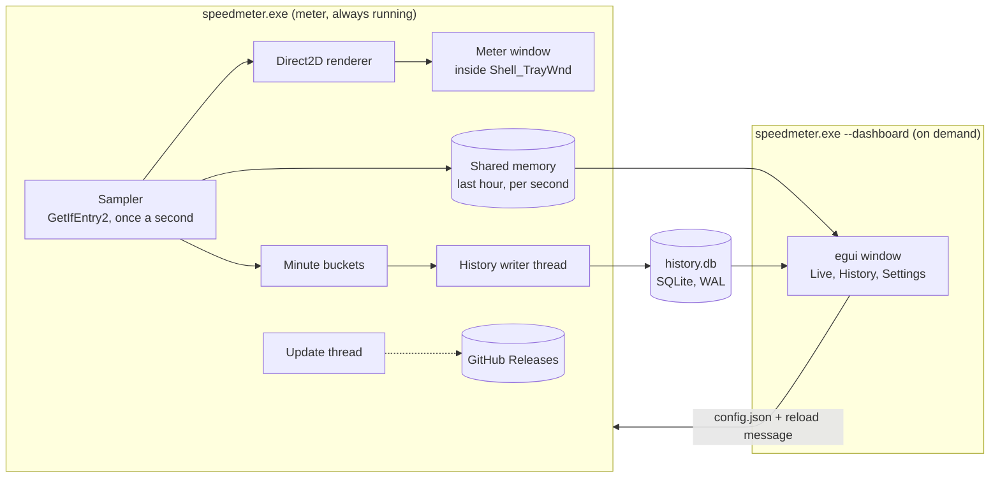

<p align="center">
  
</p>

<h1 align="center">SpeedMeter</h1>

<p align="center">
  A network speed meter that lives in the Windows 11 taskbar, with live charts and a full traffic history.<br>
  Written in Rust. Native, small, and quiet on resources.
</p>

<p align="center">
  <a href="https://github.com/PercyGFX/speedmeter/releases/latest"><b>Download the latest release</b></a>
  &nbsp;&nbsp;|&nbsp;&nbsp; Windows 11, 64-bit (Windows 10 1809+ should also work)
</p>

<p align="center">
  
</p>

---

## Contents

- [Features](#features)
- [Screenshots](#screenshots)
- [Install](#install)
- [Using SpeedMeter](#using-speedmeter)
- [Settings reference](#settings-reference)
- [Your data](#your-data)
- [Updates](#updates)
- [Uninstall](#uninstall)
- [Build from source](#build-from-source)
- [How it works](#how-it-works)
- [Releasing a new version](#releasing-a-new-version)
- [Troubleshooting](#troubleshooting)

## Features

**In the taskbar**

- Upload and download speed, right next to the tray icons. Or after your app icons, or in a floating window you can drag anywhere.
- Units scale on their own: KB/s, then MB/s, then GB/s (or Kbps, Mbps, Gbps). Numbers keep three digits, so the meter never jumps in width.
- **Speed colors.** The numbers stay white while the connection is calm, then turn blue, amber and red as traffic gets heavier. You choose the thresholds.
- **Animations, if you want them.** Numbers roll smoothly between readings, a busy direction grows with the traffic, and fine speed streaks trail behind heavy downloads. Off by default, and they respect Windows' own "Animation effects" setting.
- Crisp text on the translucent Windows 11 taskbar (per-pixel alpha, no jagged color-key edges), sized for your display scaling, light or dark taskbar.
- Hover for today's and this month's totals. Double-click to open the window. Right-click for everything else.

**In the window**

- **Live:** large readouts and a mirrored chart, download above the line and upload below, colored by how busy each second was. 1 minute to 1 hour.
- **History:** totals by hour, day, month, year or all time, with a calendar heatmap and a list of every period. Click any bar, day or row to drill in.
- **Settings:** every option applies instantly, no Save button.

**Around it**

- Pick what to measure: **Automatic** (follows the adapter Windows uses for the internet, switching between Ethernet and Wi-Fi as needed), **All networks combined**, or one specific adapter.
- Starts with Windows. Optional tray icon. Dark and light themes.
- **Updates itself** from GitHub Releases, checks each download against GitHub's SHA-256, and installs quietly.
- Light: the always-running part uses about 11 MB of memory and around 0.2% of one CPU core. The window runs as a separate process, so its memory is returned when you close it.

## Screenshots

<p align="center"></p>
<p align="center"><sub>Live: the last minute of traffic. Bars above the line are download, below are upload.</sub></p>

<p align="center"></p>
<p align="center"><sub>History: a month at a glance. Click a day to see it hour by hour.</sub></p>

<p align="center"></p>
<p align="center"><sub>Settings: Windows 11 style, applied as you change them.</sub></p>

<p align="center"><sub>Screenshots use sample data.</sub></p>

## Install

1. Download `SpeedMeter-Setup-x.y.z.exe` from the [latest release](https://github.com/PercyGFX/speedmeter/releases/latest).
2. Run it. It installs for your user only, into `%LOCALAPPDATA%\Programs\SpeedMeter`, so it doesn't ask for administrator rights.
3. SpeedMeter starts, the meter appears next to the tray icons, and the window opens once so you can look around.

> **"Windows protected your PC"?** The installer isn't code-signed yet, so SmartScreen may warn about it the first time. Choose **More info**, then **Run anyway**.

## Using SpeedMeter

### The taskbar meter

| Do this | To |
| --- | --- |
| Hover | See the connection name and today's and this month's totals |
| Double-click | Open the SpeedMeter window |
| Right-click | Open the menu |
| Drag (floating mode) | Move the floating meter; its position is remembered |

### The right-click menu

- **Open SpeedMeter**, **Traffic history**, **Settings**: open the window on that page.
- **Network**: Automatic, All networks combined, or a specific adapter. **Refresh list** rescans adapters.
- **Widget position**: next to the tray icons, left side of the taskbar, or a floating window.
- **Speed units**: bytes (MB/s) or bits (Mbps).
- **Color speeds when busy**, **Animations**, **Start with Windows**: quick toggles.
- **Exit SpeedMeter**: stops the meter and recording. History is saved first.

### Speed colors

| Color | Default range | Meaning |
| --- | --- | --- |
| White (gray in charts) | under 1 MB/s | Calm |
| Blue | 1 to 10 MB/s | Busy |
| Amber | 10 to 40 MB/s | Heavy |
| Red | over 40 MB/s | Very heavy |

Change the thresholds in **Settings > Speed colors**. In the History charts, the same four colors show how each day (or month) compares with the busiest one in view.

### Choosing a network

- **Automatic** asks Windows which adapter it would use to reach the internet and measures that one. If you switch from Ethernet to Wi-Fi, or connect a full-tunnel VPN, it follows within about 10 seconds.
- **All networks combined** adds every connected adapter. Virtual adapters (Hyper-V, WSL, VPNs) can carry the same traffic as your real adapter, so totals can be counted twice.
- **A specific adapter** measures only that one, even while it's disconnected (it shows zero until it comes back).

Disconnected adapters are tucked away under **Show N disconnected adapters** in Settings.

## Settings reference

Settings live in `%LOCALAPPDATA%\SpeedMeter\config.json`. The window and the right-click menu edit this file for you; you can also edit it by hand while SpeedMeter is closed.

| Key | Default | Description |
| --- | --- | --- |
| `connection` | `{ "mode": "auto" }` | `auto`, `all`, or `{ "mode": "adapter", "id": "{GUID}", "name": "Ethernet" }` |
| `placement` | `taskbar_right` | `taskbar_right`, `taskbar_left` or `floating` |
| `offset` | `0` | Extra distance from the meter's anchor, in pixels at 100% scaling |
| `floating_pos` | `null` | Last position of the floating meter `[x, y]` |
| `layout` | `stacked` | `stacked` (two lines) or `inline` (one line) |
| `upload_first` | `true` | Which line comes first |
| `font` | `Bahnschrift` | Any installed font family; the window offers four that work well |
| `font_size` | `12.0` | 9 to 16 |
| `show_arrows` | `true` | Arrows next to the numbers |
| `animations` | `false` | Rolling numbers, growth and speed streaks |
| `unit` | `bytes` | `bytes` (KB/s, MB/s) or `bits` (Kbps, Mbps) |
| `decimals` | `auto` | `auto` (three digits), `one` or `two` |
| `heat` | on; 1, 10, 40 MB/s | `{ "enabled": true, "busy": 1048576, "heavy": 10485760, "extreme": 41943040 }` in bytes per second |
| `start_with_windows` | `true` | Adds or removes the sign-in entry |
| `show_tray_icon` | `true` | Notification-area icon |
| `theme` | `system` | Window colors: `system`, `dark` or `light` |
| `keep_minutes_days` | `30` | Days of minute-by-minute detail to keep |
| `auto_update` | `true` | Install new versions in the background |

## Your data

Everything stays on your PC, in `%LOCALAPPDATA%\SpeedMeter`:

| File | What it holds |
| --- | --- |
| `history.db` | SQLite database. One row per minute with traffic (kept for `keep_minutes_days`) and one row per day (kept forever), with peak speeds. |
| `config.json` | Your settings. |
| `speedmeter.log` | Problems worth knowing about, such as a failed update check. Usually empty or missing. |

SpeedMeter makes one kind of network request of its own: the update check to `api.github.com` (twice a day, plus when you open the window). Nothing else leaves your machine.

**Settings > Data** lets you change how long minute detail is kept, open the folder, or clear all history.

## Updates

- The installed app checks GitHub for a newer release a couple of minutes after it starts, then every 12 hours.
- With **Install updates automatically** on (the default), it downloads the installer, verifies its SHA-256 against the digest GitHub publishes, and runs it silently. The installer closes SpeedMeter (saving the minute in progress), upgrades it, and starts it again. Your history and settings are untouched.
- With it off, the window shows **Update to x.y.z** in the sidebar and in **Settings > Updates**, and nothing happens until you click it.
- Only the installed copy updates itself. A copy you run from somewhere else (or a development build) never replaces itself.

## Uninstall

**Settings > Apps > Installed apps > SpeedMeter > Uninstall.** The uninstaller closes SpeedMeter, removes it and its sign-in entry, and asks whether to delete your history and settings too.

## Build from source

### Requirements

- Windows 11 (or 10), 64-bit
- [Rust](https://rustup.rs) stable with the MSVC toolchain (`x86_64-pc-windows-msvc`)
- Visual Studio Build Tools with the Windows SDK (for the C compiler and `rc.exe`, used for the icon and manifest)
- Optional: [Inno Setup 6](https://jrsoftware.org/isinfo.php) to build the installer (`winget install JRSoftware.InnoSetup`)
- Optional: Python 3 with Pillow, only to regenerate the icon or sample data

### Build and run

```powershell
git clone https://github.com/PercyGFX/speedmeter.git
cd speedmeter
cargo run --release            # starts the meter and opens the window
cargo test                     # unit tests
.\installer\build.ps1          # tests, release build and installer -> installer\Output\
```

### Command-line flags

| Flag | Effect |
| --- | --- |
| *(none)* or `--open` | Start the meter if needed and open the window |
| `--background` | Start only the meter (used at sign-in) |
| `--dashboard` | Open only the window |
| `--page live\|history\|settings` | Which page the window opens on |
| `--quit` | Close every running SpeedMeter cleanly (used by the installer) |

### Environment variables

| Variable | Effect |
| --- | --- |
| `SPEEDMETER_DEMO=1` | The meter shows a synthetic sweep from a trickle to 80 MB/s instead of real traffic, and records nothing. Handy for trying the colors and animations. |
| `SPEEDMETER_DATA_DIR=<folder>` | Use another folder for `config.json` and `history.db`. `python tools/make_demo_history.py <folder>` fills one with sample history. |

### Project layout

```
src/
  main.rs              entry point and command-line flags
  anim.rs              rolling numbers, growth spring, color crossfade
  config.rs            settings (config.json)
  format.rs            KB/s -> MB/s -> GB/s formatting
  heat.rs              speed tiers and their colors
  history.rs           SQLite storage and queries
  net.rs               adapters, byte counters, automatic selection
  shared.rs            shared-memory ring buffer (meter -> window)
  sys.rs               Windows helpers: registry, theme, sign-in entry
  update.rs            GitHub release check, download, verify, install
  monitor/             the always-running meter
    mod.rs             one-second tick, minute buckets, menu, tray
    render.rs          Direct2D and DirectWrite drawing
    widget.rs          the meter window (in the taskbar or floating)
    taskbar.rs         finding the taskbar and the meter's slot
    layout.rs          UI Automation: where the taskbar buttons are
    tray.rs            notification-area icon
  dashboard/           the window
    mod.rs             app state, navigation, polling, updates
    live.rs            Live page
    history_view.rs    History page
    settings.rs        Settings page
    charts.rs          waveform, mirrored bars, calendar, table
    theme.rs           colors, fonts, egui style
    ui.rs              Windows 11 style controls
assets/                icon, application manifest, resource script
installer/             Inno Setup script and local build script
tools/                 icon generator and sample-data generator
.github/workflows/     CI and the release pipeline
```

## How it works

One executable plays two roles. The meter is a plain Win32 program that runs all the time; the window is an [egui](https://github.com/emilk/egui) app that only runs while it's open.



- **Counting traffic.** Adapters come from `GetAdaptersAddresses` (one entry per real adapter, without the filter-driver duplicates). Every second, `GetIfEntry2` reads each adapter's 64-bit byte counters; the difference divided by the measured time gives the speed. Counters that go backwards (an adapter reset) or imply more than 100 Gbit/s are ignored. Automatic mode asks `GetBestInterfaceEx` which adapter routes to the internet.
- **Living in the taskbar.** The meter is a layered window re-parented into `Shell_TrayWnd`, so it moves and hides with the taskbar and never floats over full-screen games. It's drawn with Direct2D and DirectWrite into a 32-bit premultiplied bitmap and shown with `UpdateLayeredWindow`, which gives clean anti-aliased text on the translucent taskbar. The tray area's position comes from `TrayNotifyWnd`; the app icons' positions come from UI Automation (the Windows 11 taskbar is XAML, so its buttons have no window handles), read on a background thread so the taskbar never waits on SpeedMeter. If Explorer restarts, the meter re-attaches on the next tick.
- **History.** Each minute's bytes and peak speeds go to a writer thread that upserts a `minute` row and a `day` row (keyed by your local date) in SQLite. Hour views are built from minutes; month, year and all-time views from days.
- **Live data for the window.** The meter writes each second's reading into a one-hour ring buffer in a named file mapping, guarded by a sequence counter so the window never reads half an update.
- **Settings.** The window saves `config.json` and posts a message to the meter, which reloads it. Changes made from the right-click menu are picked up by the window within a second.

## Releasing a new version

1. Set the new `version` in `Cargo.toml` (for example `0.2.0`), build once so `Cargo.lock` updates, and commit both.
2. Tag and push:

   ```powershell
   git tag v0.2.0
   git push origin main v0.2.0
   ```

3. The [Release workflow](.github/workflows/release.yml) runs the tests, builds the release exe and the installer, and publishes `SpeedMeter-Setup-0.2.0.exe` on a new GitHub Release with generated notes. It stops if the tag and the `Cargo.toml` version don't match.
4. Installed copies pick it up within 12 hours (or right away from **Settings > Updates > Check for updates**).

The repository has to stay public for installed copies to see new releases without a token.

**Code signing (optional).** To remove the SmartScreen warning, sign `speedmeter.exe` and the installer before publishing, for example with Azure Trusted Signing or a code-signing certificate, by adding a signing step to the workflow after "Build" and after "Build installer".

## Troubleshooting

| Problem | Try this |
| --- | --- |
| The meter covers some icons | **Settings > Taskbar meter > Fine-tune position**, or switch **Position**. |
| The meter disappeared | It re-attaches within a second after Explorer restarts. If it's still missing, open SpeedMeter from the Start menu. |
| Speeds look doubled | You're probably on **All networks combined** with virtual adapters. Switch to **Automatic**. |
| Speeds stay at zero | Check **Settings > Network**: a specific adapter may be selected while it's disconnected. |
| No animations | They're off by default (right-click > **Animations**). They also stay off while Windows' **Animation effects** setting is off. |
| Something else | Look in `%LOCALAPPDATA%\SpeedMeter\speedmeter.log`, and open an [issue](https://github.com/PercyGFX/speedmeter/issues) with what it says. |

## Credits

Inspired by [TrafficMonitor](https://github.com/zhongyang219/TrafficMonitor). Built with [egui](https://github.com/emilk/egui), [windows-rs](https://github.com/microsoft/windows-rs), [rusqlite](https://github.com/rusqlite/rusqlite) and [ureq](https://github.com/algesten/ureq). Numbers are set in Bahnschrift and text in Segoe UI, both included with Windows.
