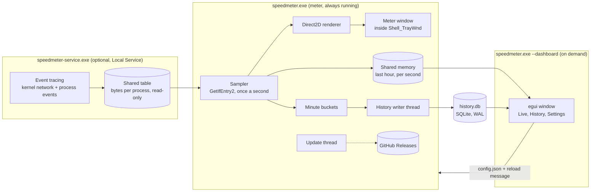

# How SpeedMeter works

[Back to the README](../README.md) · [Building](building.md) · [Settings reference](settings.md)

One executable plays two roles. The meter is a plain Win32 program that runs all the time; the window is an [egui](https://github.com/emilk/egui) app that only runs while it's open. A second, optional executable counts traffic per app.

## Counting traffic

Adapters come from `GetAdaptersAddresses` (one entry per real adapter, without the filter-driver duplicates). Every second, `GetIfEntry2` reads each adapter's 64-bit byte counters; the difference divided by the measured time gives the speed. Counters that go backwards (an adapter reset) or imply more than 100 Gbit/s are ignored. Automatic mode asks `GetBestInterfaceEx` which adapter routes to the internet.

## Living in the taskbar

The meter is a layered window re-parented into `Shell_TrayWnd`, so it moves and hides with the taskbar and never floats over full-screen games. It's drawn with Direct2D and DirectWrite into a 32-bit premultiplied bitmap and shown with `UpdateLayeredWindow`, which gives clean anti-aliased text on the translucent taskbar. The tray area's position comes from `TrayNotifyWnd`; the app icons' positions come from UI Automation (the Windows 11 taskbar is XAML, so its buttons have no window handles), read on a background thread so the taskbar never waits on SpeedMeter. If Explorer restarts, the meter re-attaches on the next tick.

## History

Each minute's bytes and peak speeds go to a writer thread that upserts a `minute` row and a `day` row (keyed by your local date) in SQLite. Hour views are built from minutes; month, year and all-time views from days.

## Live data for the window

The meter writes each second's reading, and the busiest apps of that second, into a one-hour ring buffer in a named file mapping, guarded by a sequence counter so the window never reads half an update.

## Settings

The window saves `config.json` and posts a message to the meter, which reloads it. Changes made from the right-click menu are picked up by the window within a second.

## Data limits

Limits are counted from SpeedMeter's own totals, the same ones the meter shows (`limits.rs`). Today comes from the meter's running total; the rest of the week (from Monday) and of the monthly period (from the chosen start day) comes from the `day` table, read once at start and when the period setting changes. At midnight the meter adds yesterday to the week and the monthly period in memory, or starts them over when a new one begins, so there's no race with the history writer.

Every second the meter works out each limit's usage. The bar on the meter shows the chosen limit, or the one with the highest fraction used; its color steps from blue to amber at 80% and red at 100%. Notifications go out through the tray icon (a balloon, which Windows shows as a toast and holds back during Do not disturb). If the icon is hidden, it appears for 30 seconds to carry the notification.

Notifications come in steps: 80%, 100%, then every 25%. The highest step notified for each period is kept in `limits.json`, keyed by the period and its first day, so restarting doesn't repeat one and a new period starts fresh.

## Per-app counting

Which process sent which bytes is only visible through Windows event tracing, and starting a trace session takes an administrator or a service account. So that part lives in a separate, optional service, `speedmeter-service.exe`, and the rest of SpeedMeter stays a normal per-user app.

**The service.** It runs a private real-time ETW session with two kernel providers:

- `Microsoft-Windows-Kernel-Network`: bytes sent and received over TCP and UDP, with the process id and the local and remote addresses.
- `Microsoft-Windows-Kernel-Process`: which exe each process id belongs to (start, stop, and a rundown of what's already running).

Each network event type's layout is read once through TDH (Windows' own event decoder) and after that straight from the payload, because these events can arrive thousands of times a second. Only "data sent" and "data received" events count; connects, retransmits and copies would count bytes twice. Loopback traffic is skipped. The local address is matched to its adapter, and the service keeps a running total per process and adapter.

Twice a second it rewrites those totals into a global file mapping. Remote addresses are used only to spot loopback and are never stored or published.

**The meter.** Every second it copies that table and takes the differences, so a late or missed read loses nothing. It keeps only:

- the adapters it's measuring (the same choice as the speeds),
- the signed-in user's own processes and Windows services (other users' apps end up in Other).

Each process becomes an app: its exe path, the group of services in a shared `svchost.exe` (named with `GetServiceDisplayNameW`), or System. A minute's worth goes to `app_hour` and `app_day` next to the `minute` row. Whatever the meter measured beyond what apps account for (packet headers, other users, timing) is stored as Other, so the apps always add up to the minute's total.

The meter also hands each second's busiest apps to the window. Its live list waits until an app's traffic spans about 3 seconds (pauses under 2.5 seconds don't break the stretch) and drops it after 4 quiet seconds, so one-off blips don't flash by. That's only the live list; the history counts everything.

**Names and icons.** An app is named from its exe's version info ("Firefox") when it first appears, falling back to the file name. The window draws icons through the shell (`IShellItemImageFactory`), the same ones Explorer shows; Microsoft Store apps use their package logo.

### Security design of the counter

- **No driver, no kernel code.** It consumes events the kernel already publishes. A crash stops only the service, which Windows restarts.
- **Least privilege.** It runs as `NT AUTHORITY\LocalService`, not an administrator. Its service configuration keeps only `SeCreateGlobalPrivilege` (to create the shared table) and `SeChangeNotifyPrivilege`; everything else Local Service normally holds, such as impersonation, is removed.
- **Not replaceable by a normal program.** The installed copy lives in `C:\Program Files\SpeedMeter`, which only administrators can write to. The self-updater, which runs without admin rights, never touches it; a newer counter is installed only after an administrator approves it.
- **Read-only output, no input.** The shared table's security descriptor gives full access to System, Local Service and administrators and read access to signed-in users. The service accepts no commands besides the service manager's stop.
- **Minimal data.** Only process ids, exe paths and byte counts leave the service. Addresses, ports and content are never published or stored.
